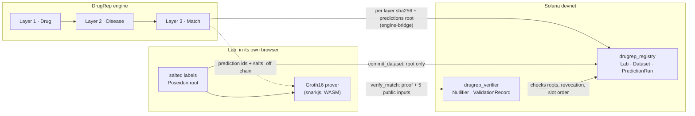

# DrugRep Proof Layer

DrugRep predictions anchored on Solana before outcomes exist, then checked against private lab data with zero knowledge proofs.

**Live app (Solana devnet):** https://drugrep-proof-layer.vercel.app
**Demo video:** https://drugrep-proof-layer.vercel.app/demo/drugrep-proof-layer-demo.mp4 (also in the repo at [demo/drugrep-proof-layer-demo.mp4](demo/drugrep-proof-layer-demo.mp4))
**Motto:** Every drug deserves a second chance.

> Devnet proof of concept. All drugs, scores and lab labels in this repo and the app are **demo data** shaped like real engine output. They are not model output and not trial or patient data. The Groth16 trusted setup is a single party test setup and is not secure for production.

## What it does

DrugRep is an AI engine that finds new uses for approved drugs, in three layers:

1. **Drug:** splits each molecule into functional motifs and predicts the proteins they bind.
2. **Disease:** turns each disease into a molecular signature, a ranked list of proteins.
3. **Match:** matches the two and returns a repurposing score plus the protein path that explains it.

The engine covers 4,498 approved drugs (DrugBank), 5,574 diseases (PrimeKG) and 9,208 proteins (UniProt). It is not in this repo. This repo is the Solana layer around its outputs:

- **Traceability.** Every run's inputs, model version and each layer's output are hashed separately and anchored on chain, so any result traces back layer by layer.
- **Timestamp.** Every run gets an on chain slot and time before any clinical result exists, which proves the prediction came first.
- **Zero knowledge trial matching.** A lab proves how many of a run's top predictions its private data confirms. Only a Groth16 proof leaves the lab, and a Solana program verifies it.
- **Data sovereignty.** Data stays with its owner under its own key. Only roots, proofs and attestations go on chain, and the owner can revoke.

## Deployed programs (devnet)

| Program | Address |
| --- | --- |
| `drugrep_registry` | [`Heqv7iDHvG2YGsiMnXMNSTgMxAAcWja1QoFx4fGnd7xt`](https://explorer.solana.com/address/Heqv7iDHvG2YGsiMnXMNSTgMxAAcWja1QoFx4fGnd7xt?cluster=devnet) |
| `drugrep_verifier` | [`HkJreUgMDofiQJAZ4pRj8vt4pZ3hVkJ8hSmSULcf3qij`](https://explorer.solana.com/address/HkJreUgMDofiQJAZ4pRj8vt4pZ3hVkJ8hSmSULcf3qij?cluster=devnet) |

The same IDs are in `Anchor.toml`, `sdk/src/constants.ts` and the app.

## Architecture



Accounts, seeds, instruction flows and the threat model are in [docs/ARCHITECTURE.md](docs/ARCHITECTURE.md). Decisions and library quirks are in [docs/NOTES.md](docs/NOTES.md).

## What is on chain vs what stays private

| On chain | Stays private |
| --- | --- |
| sha256 of the model version, the inputs and each layer's output | The run export itself: drug and disease names, scores, protein paths, motif-residue pairs |
| Poseidon root of the ranked predictions, top k, slot, time, committer | Prediction salts (shared with the lab off chain) |
| Poseidon root of a lab's salted labels, record count, schema version | The lab's records, outcomes, salts and lab secret |
| Proof result: hits, k, hit rate, nullifier, "predicted first" flag | Which predictions matched, and any patient level data |
| Revocation flag and slot | Nothing about the data itself |

## Repository layout

```
programs/      drugrep_registry and drugrep_verifier (Anchor 1.2.1) with LiteSVM tests
circuits/      trial_match.circom, POC trusted setup scripts, prover artifacts, tests
sdk/           shared TypeScript: hashing, Poseidon commitments, proof encoding, program clients
engine-bridge/ run export -> per layer hashes + predictions root -> commit_prediction_run; demo fixtures
lab-sim/       simulated lab: salted labels, root, commit_dataset, revoke
app/           Next.js web app (wallet adapter, in browser proving), deployed to Vercel
scripts/       e2e-devnet.ts, deploy-devnet.sh, vk-to-rust.ts, sync-idl.sh
demo/          video recorder (Playwright), assembler (ffmpeg), video, voiceover and pitch scripts
docs/          ARCHITECTURE.md, NOTES.md
```

`tests/` lives next to the code it tests: `programs/*/tests`, `circuits/test`, `sdk/test`.

## Run it locally

Prerequisites: Node 20.18+, pnpm, Rust, Solana CLI 4.1.2 and Anchor 1.2.1 (`avm install 1.2.1`). Circom 2.2.3 is only needed to recompile the circuit.

```bash
pnpm install
```

```bash
pnpm app:dev
```

That runs the app against devnet at http://localhost:3000. To run everything on a local validator instead:

```bash
NO_DNA=1 anchor build && solana-test-validator --reset --bpf-program Heqv7iDHvG2YGsiMnXMNSTgMxAAcWja1QoFx4fGnd7xt target/deploy/drugrep_registry.so --bpf-program HkJreUgMDofiQJAZ4pRj8vt4pZ3hVkJ8hSmSULcf3qij target/deploy/drugrep_verifier.so
```

```bash
RPC_URL=http://127.0.0.1:8899 pnpm e2e:devnet
```

```bash
cd app && NEXT_PUBLIC_CLUSTER=localnet npx next dev
```

In the app, pick any devnet wallet, or the "Demo wallet (devnet burner)" that lives in your browser and can request an airdrop.

### Command line tools

```bash
pnpm bridge:commit
```

Hashes the demo run export layer by layer and anchors it. `--dry-run` prints the hashes only; `--fixture <file>` reads another export; `--engine-url <url> --run-id <id>` reads from the engine API through the `EngineSource` interface in `engine-bridge/src/engine.ts`.

```bash
pnpm --filter @drugrep/lab-sim generate && pnpm lab:commit
```

Builds a salted private dataset in `lab-sim/private/` (git ignored) and commits only its root.

```bash
pnpm e2e:devnet
```

Runs the full flow on devnet and prints Explorer links: commit a run, commit a lab root, prove, verify, reject a replay, verify a late run without the "predicted first" flag, revoke.

## Tests

```bash
pnpm test:programs
```

Builds both programs and runs 18 LiteSVM tests, including real Groth16 proofs, replay, late runs, revocation, wrong roots, tampered proofs, k mismatch and foreign accounts.

```bash
pnpm test:circuit
```

Valid proof, hits counted only inside top k, wrong hits, tampered roots, flipped labels, wrong nullifier or secret, deterministic nullifier, k out of range, duplicate predictions, proof byte encoding.

```bash
pnpm test:sdk
```

Hashing, Merkle layout, pair ids, Poseidon cross-checked against circomlibjs, G2 encoding.

CI (`.github/workflows/ci.yml`) runs program format, build, clippy and tests; circuit compile and tests; SDK tests; and app typecheck, lint and build on every push.

## Security notes

- **POC trusted setup.** `circuits/scripts/setup.sh` runs powers of tau and phase 2 on one machine with one contributor. Whoever ran it could forge proofs. Production needs a public phase 1 and a multi party phase 2. Rerunning the setup changes the verifying key, which requires a program upgrade.
- **Devnet only.** Nothing here is deployed to mainnet. The demo burner wallet stores its key in browser storage and must never hold real funds.
- **Demo data.** The fixtures in `engine-bridge/fixtures/` are hand written, marked `"demo": true`, and labelled as demo data in the app and the video.
- **Run attribution.** `commit_prediction_run` is permissionless and records the committer. Production should gate it behind an engine authority or an attestation credential.
- **Unaudited.** The programs and the circuit have tests but no external audit.

## Roadmap

- **SP1 zkVM** for the full evaluation logic (ranking metrics, per indication thresholds) as ordinary Rust, verified on Solana.
- **Arcium MPC** to pool outcomes from several trial sites without any site seeing the others.
- **Solana Attestation Service credentials** so labs, sponsors and the DrugRep engine are verified issuers.
- **ZK Compression** to anchor every single prediction, not only a root per run, at low cost.
- **Mainnet**, after a multi party trusted setup and an audit.

## Built with

- [Anchor](https://www.anchor-lang.com) 1.2.1
- [groth16-solana](https://github.com/Lightprotocol/groth16-solana) (Light Protocol) for on chain Groth16 verification with the alt_bn128 syscalls
- [Circom](https://github.com/iden3/circom) 2.2.3 and [circomlib](https://github.com/iden3/circomlib) (Poseidon, comparators)
- [snarkjs](https://github.com/iden3/snarkjs) for the trusted setup and in browser proving
- [poseidon-lite](https://github.com/vimwitch/poseidon-lite) for Poseidon in TypeScript, cross-checked against circomlibjs
- [@solana/web3.js](https://github.com/solana-foundation/solana-web3.js) and [@anchor-lang/core](https://www.npmjs.com/package/@anchor-lang/core)
- [Solana wallet adapter](https://github.com/anza-xyz/wallet-adapter)
- [LiteSVM](https://github.com/LiteSVM/litesvm) for program tests
- [Next.js](https://nextjs.org) and [Playwright](https://playwright.dev) (demo recording)

Built on Solana.

## License

MIT, see [LICENSE](LICENSE).
