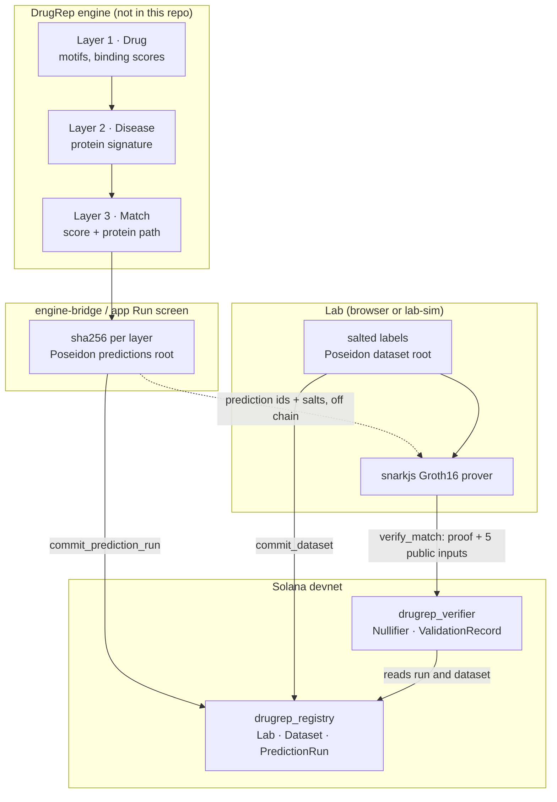

# Architecture

The DrugRep Proof Layer is two Anchor programs, one Groth16 circuit, a TypeScript SDK shared by every client, two command line tools (engine bridge, lab simulator) and a static web app. Everything on chain is a hash, a root, a proof result or a flag. Raw predictions, lab labels and anything that could identify a patient never leave their owner.



## Programs

| Program | ID |
| --- | --- |
| `drugrep_registry` | `Heqv7iDHvG2YGsiMnXMNSTgMxAAcWja1QoFx4fGnd7xt` |
| `drugrep_verifier` | `HkJreUgMDofiQJAZ4pRj8vt4pZ3hVkJ8hSmSULcf3qij` |

Both are Anchor 1.2.1 programs built for SBPF v3. The verifier depends on the registry crate (`features = ["cpi"]`) only to deserialize its account types; Anchor's `Account<'info, T>` then checks that the run and dataset accounts are owned by the registry program, so a look-alike account from another program is rejected.

## Accounts and seeds

### drugrep_registry

| Account | Seeds | Fields | Written by |
| --- | --- | --- | --- |
| `Lab` | `["lab", authority]` | authority, name_hash, dataset_count, created_slot, created_at | `register_lab` |
| `Dataset` | `["dataset", lab, dataset_root]` | lab, authority, dataset_root, record_count, schema_version, slot, timestamp, revoked, revoked_slot, revoked_at | `commit_dataset`, `revoke_dataset` |
| `PredictionRun` | `["run", run_id]` | authority, run_id, model_version_hash, input_hash, layer1_hash, layer2_hash, layer3_hash, predictions_root, top_k, slot, timestamp | `commit_prediction_run` |

`run_id` is `sha256(<engine run id>)`, so a run id can be anchored once. Slots and timestamps come from the `Clock` sysvar inside the program, not from the client.

### drugrep_verifier

| Account | Seeds | Fields |
| --- | --- | --- |
| `Nullifier` | `["nullifier", nullifier]` | nullifier, validation, slot |
| `ValidationRecord` | `["validation", nullifier]` | run, dataset, lab, submitter, predictions_root, dataset_root, nullifier, hits, k, hit_rate_bps, predicted_first, run_slot, dataset_slot, verified_slot, verified_at, revoked, revoked_slot |

## Commitments

All circuit hashes are circomlib Poseidon over the BN254 scalar field.

```
pair_id          = first 31 bytes of sha256("<drugbank_id>|<primekg_id>")
prediction leaf  = Poseidon(pair_id, salt)                  32 slots, rank order, unused slots = 0
predictions_root = binary Merkle root of the 32 leaves (depth 5)
label leaf       = Poseidon(pair_id, salt, outcome)          32 slots, unused slots = 0
labels_root      = binary Merkle root of the 32 leaves (depth 5)
dataset_root     = Poseidon(labels_root, Poseidon(lab_secret))
nullifier        = Poseidon(dataset_root, predictions_root, lab_secret)
```

The per layer hashes are `sha256` over canonical JSON (keys sorted) of the run export's `model`, `inputs`, `layer1`, `layer2` and `layer3`. Anyone holding the export can recompute them; editing one layer changes only that layer's hash.

## Circuit (`circuits/trial_match.circom`)

Public inputs, in order: `predictions_root, dataset_root, hits, k, nullifier`.

The circuit proves, without revealing anything else:

1. the 32 private prediction slots hash to `predictions_root`;
2. the 32 private label slots and the lab secret hash to `dataset_root`, and every outcome is 0 or 1;
3. `1 <= k <= 32` (k is range checked to 6 bits first);
4. `hits` equals the number of predictions with rank `< k` whose pair id matches a label with outcome 1, each prediction counting at most once;
5. predictions inside the top k are pairwise distinct;
6. `nullifier = Poseidon(dataset_root, predictions_root, lab_secret)`.

36,519 constraints after `--O2`, a 2^16 powers of tau. Proving takes about 2 seconds in a browser.

## Instruction flows

**Anchor a run.** The bridge (or the app's Run screen) loads a run export, computes the six hashes and the predictions root, and calls `commit_prediction_run`. The program checks the root is a non zero field element, `1 <= top_k <= 32`, and no hash is all zeros, then stamps slot and time. The prediction salts are kept private and shared with the lab off chain.

**Commit a dataset.** The lab builds salted labels and a secret locally, computes `dataset_root`, and calls `register_lab` (first time) and `commit_dataset`. Only the root, the record count and the schema version are sent.

**Prove and verify.** The lab proves with snarkjs in its browser and anyone submits `verify_match(proof, public_inputs)` with the run and dataset accounts. The program:

1. checks `run.predictions_root == predictions_root` and `dataset.dataset_root == dataset_root`;
2. refuses a revoked dataset;
3. requires `k == run.top_k` and `hits <= k`;
4. verifies the Groth16 proof with `groth16-solana` (alt_bn128 syscalls, about 130k CU in total);
5. computes `predicted_first = run.slot < dataset.slot`;
6. creates the `Nullifier` and `ValidationRecord` PDAs and emits `MatchVerified`.

**Revoke.** The lab calls `revoke_dataset`. Anyone can then call `sync_revocation(validation, dataset)` to copy the flag onto a record (the app does it in the same transaction as the revoke). Readers also treat a record as revoked when its dataset is revoked, so an unsynced record is never shown as active.

## Events

`LabRegistered`, `DatasetCommitted`, `PredictionRunCommitted`, `DatasetRevoked`, `MatchVerified`, `ValidationRevoked`. The app's timeline reads program accounts directly (`getProgramAccounts`) so it does not depend on log retention; the events are there for indexers.

## Threat model

| Threat | What stops it |
| --- | --- |
| **Replay**: submitting the same proof twice to inflate the validation count | The `Nullifier` PDA is created with `init`; a second transaction with the same nullifier fails because the account exists. Changing the nullifier breaks the proof, since it is a public input bound inside the circuit. Because the lab secret is committed inside `dataset_root`, the nullifier is fixed for a (dataset, run) pair, so a lab cannot mint a fresh one for the same pair. |
| **Front running**: a lab sees the predictions and builds its dataset to match | The verifier records `predicted_first = run.slot < dataset.slot` from on chain slots. A dataset committed after the run is still accepted (a lab may legitimately test old predictions) but never gets the "predicted before outcome" badge. Equal slots do not count as first. |
| **Reverse front running**: DrugRep sees a lab's data and then commits a run that matches it | DrugRep never sees the labels, only a root that hides them (salted leaves plus a secret). A run committed after the dataset would carry no badge anyway. |
| **Cherry picked cutoff**: choosing the k that maximises the hit rate | `k` must equal the `top_k` committed in the run before any proof exists. |
| **Inflated hits** from duplicate labels or duplicate predictions | The circuit constrains each prediction's match count to 0 or 1 and requires active predictions to be distinct. |
| **Revoked data**: using a dataset after its owner withdrew it | `verify_match` rejects revoked datasets; existing records are marked revoked through `sync_revocation`, and readers check the dataset flag too. |
| **Fake roots**: a proof against roots that were never registered | The program compares both public roots byte for byte against registry accounts, and Anchor checks those accounts are owned by the registry program with the right discriminator. A root squatting attempt by another wallet lands in a different PDA (`["dataset", lab, root]` is per lab). |
| **Forged proofs** | Groth16 soundness, given an honest setup. **The POC setup is not honest by construction**: one machine generated both phases, so whoever ran it could forge proofs. See Security notes in the README. |
| **Leaking private data** | Salts are random field elements per leaf and the dataset root also absorbs a secret, so roots do not reveal which pairs or outcomes are inside, even for small sets. The proof is zero knowledge; only `hits`, `k`, the roots and the nullifier are public. |
| **Attribution of runs** | `commit_prediction_run` is permissionless in the POC and stores the committer. Production should gate it behind a DrugRep engine authority or a Solana Attestation Service credential. |

## What is deliberately out of scope for the POC

- The predictions root commits to ranked pair ids, not to the scores or paths. Those are covered by `layer3_hash`.
- The circuit checks set membership and counting. Richer evaluation logic (ranking metrics, per indication thresholds) is the SP1 zkVM item on the roadmap.
- One lab proves against its own data. Pooling several sites without any of them seeing the others is the Arcium MPC item on the roadmap.
